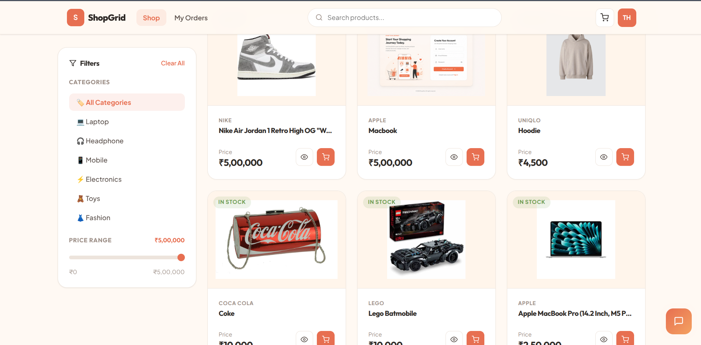
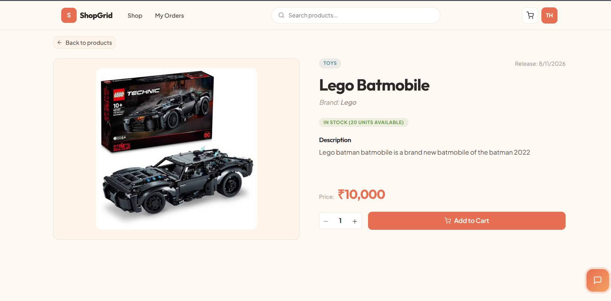
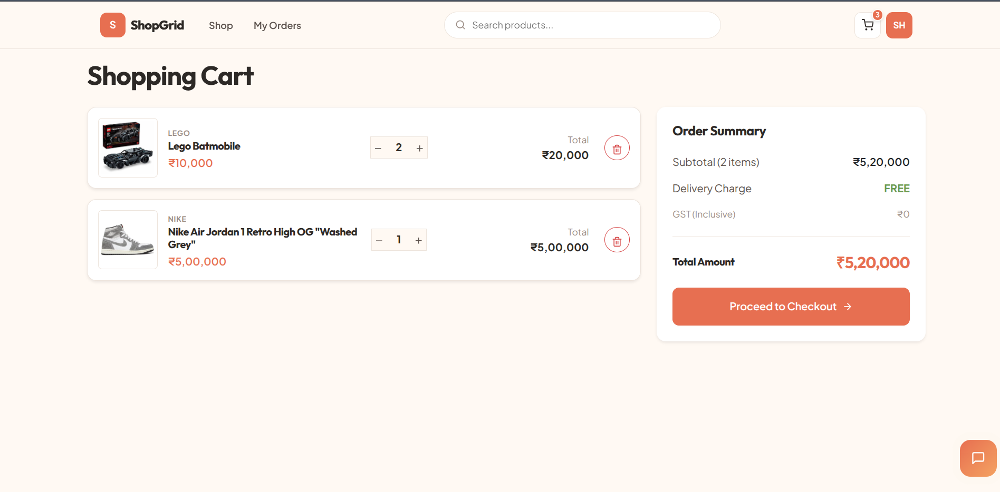
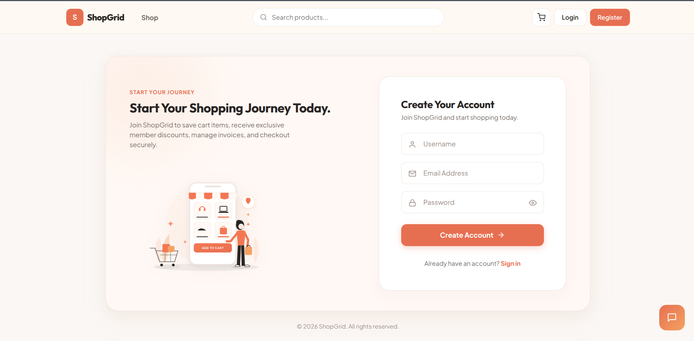
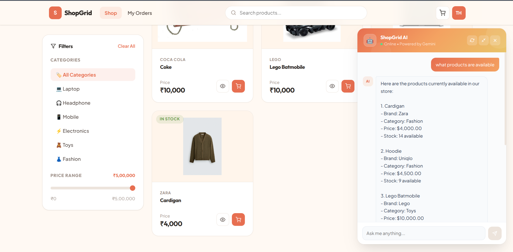
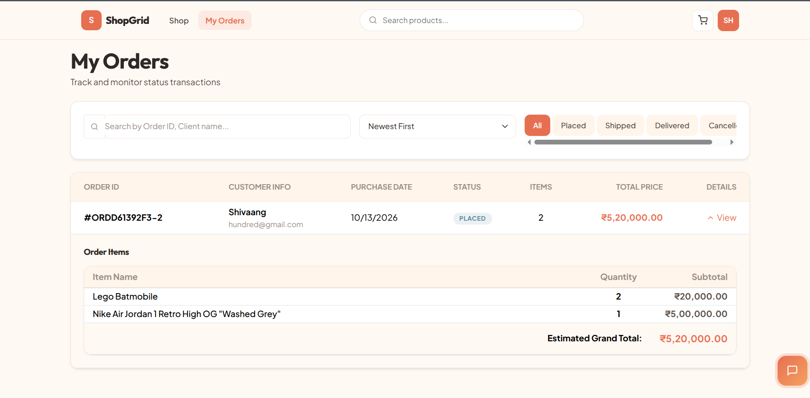

# ShopGrid eCommerce Backend

## Project Overview

**ShopGrid** is a high-performance eCommerce backend application built with **Java Spring Boot 3.x** and designed using clean, layered architecture principles. It exposes RESTful APIs for user authentication, product management, transactional order processing, and features intelligent AI integrations powered by Google Gemini and PostgreSQL `pgvector`, alongside robust Redis caching.

The application bridges modern web backend engineering with artificial intelligence?enabling Retrieval-Augmented Generation (RAG) for conversational store navigation, automated AI-driven product metadata generation, and real-time semantic search over catalog and order history.

---

## Live Deployment
⚠️
> **Note:** The backend service is hosted on Render's free tier. If the service has been inactive, the initial request may take approximately **1?2 minutes** while the instance spins up. Subsequent requests will respond at normal operating speeds.

---

## Key Features

- **Stateless Authentication & Authorization:** Role-based access control (`ROLE_ADMIN` vs `ROLE_USER`) using Spring Security and JWT.
- **High-Performance Caching:** Database query results cached via Spring Cache (`@Cacheable`, `@CacheEvict`, `@Caching`) backed by Redis to ensure low-latency response times on high-read catalog endpoints.
- **Atomic Order Management:** Multi-step checkout pipeline validating stock availability, updating inventory, and creating orders within `@Transactional` boundaries.
- **AI-Powered Store Assistant (RAG):** Interactive chatbot powered by Google Gemini GenAI that queries vector embeddings of store inventory and order history.
- **Automated Content Generation:** Seamless AI generation of rich product descriptions during product creation.
- **Semantic Vector Search:** Deep contextual search across products and order summaries using PostgreSQL `pgvector` embeddings.
- **Aspect-Oriented Programming (AOP):** Centralized execution logging, request validation, and performance monitoring aspects to maintain clean business logic.

---

## Application Screenshots

### Product Catalog
Browse products, filter by category, and explore the catalog.



### Product Details
View product information, stock availability, pricing, and add items to the cart.



### Shopping Cart
Review quantities, item totals, and the order summary before checkout.



### User Registration
Create an account to start shopping.



### ShopGrid AI Assistant
Ask product-related questions using the AI-powered store assistant.



### Order History
Review orders, their statuses, and itemized totals.




## Tech Stack

### Application

- **Java 21 / 25:** Modern Java runtime providing virtual threads and enhanced language features for high concurrency.
- **Spring Boot 3.x:** Core backend framework providing auto-configuration, dependency injection, and REST API controllers.
- **Spring Security:** Enterprise security framework enforcing stateless authentication, CORS policies, and request filters.
- **JWT (JSON Web Tokens):** Cryptographically signed, self-contained tokens used for authenticating stateless API requests.
- **Spring Data JPA / Hibernate:** Object-relational mapping (ORM) layer for type-safe database queries and schema management.
- **Spring AI:** Abstraction framework for connecting Java applications with LLMs, embedding models, and vector databases.
- **Spring AOP:** Aspect-Oriented Programming framework used to separate cross-cutting concerns like logging and performance auditing from core business logic.

### Data & Infrastructure

- **Supabase PostgreSQL:** Managed cloud PostgreSQL database hosting operational relational tables and application domain models.
- **PostgreSQL `pgvector`:** Extension hosted within Supabase PostgreSQL to store and query high-dimensional vector embeddings directly inside the database without requiring a separate vector store infrastructure.
- **Upstash Redis:** Cloud-managed serverless Redis instance used for caching high-frequency read operations to minimize database query load and reduce latency.
- **Render:** Cloud application platform hosting the containerized Spring Boot backend service.

### AI & Intelligence

- **Google Gemini API (`gemini-3.6-flash`):** Foundation AI model powering conversational store interactions and automated text generation.
- **RAG (Retrieval-Augmented Generation):** Pattern combining vector search context retrieval with prompt engineering for factual, store-aware AI responses.
- **Vector Embeddings (`gemini-embedding-001`):** 768-dimensional numerical representations of catalog products and order summaries.

---

## Security & Authentication

The application implements a stateless security model centered around JWT tokens and Spring Security filters:

1. **Authentication Flow:** Users log in via `/api/auth/login` with valid credentials. Upon verification via `BCryptPasswordEncoder`, the backend returns a signed JWT token containing user identity and granted authorities.
2. **Stateless Request Processing:** `JwtAuthenticationFilter` intercepts incoming HTTP requests, extracts the `Authorization: Bearer <token>` header, validates token signature and expiration, and populates the `SecurityContextHolder`.
3. **Role-Based Authorization:**
   - **`ROLE_ADMIN`:** Granted administrative privileges, including product creation, updates, deletion, catalog cache eviction, and viewing global system orders.
   - **`ROLE_USER`:** Permitted to browse products, execute semantic searches, place transactional orders, view personal order history, and interact with the AI assistant.
4. **Data Seeding:** Admin credentials are automatically initialized upon startup if no administrative account exists, using configurable properties.

---

## Product Catalog & Redis Caching

High-read e-commerce catalog endpoints can create heavy database load. ShopGrid leverages **Spring Cache** backed by **Upstash Redis** to maximize read throughput and achieve low-latency responses.

## AI / RAG / Vector Search

ShopGrid integrates **Spring AI** with **Google Gemini** and **PostgreSQL `pgvector`** to deliver intelligent, context-aware store interactions.


## API Endpoints Summary

### Authentication (`/api/auth`)

| Method | Endpoint | Access | Description |
| :--- | :--- | :--- | :--- |
| `POST` | `/api/auth/register` | Public | Register a new user account |
| `POST` | `/api/auth/login` | Public | Authenticate user and receive a JWT token |

### Products (`/api`)

| Method | Endpoint | Access | Description |
| :--- | :--- | :--- | :--- |
| `GET` | `/api/products` | Public / User | List all products (Cached via Redis) |
| `GET` | `/api/product/{id}` | Public / User | Get product by ID (Cached via Redis) |
| `GET` | `/api/product/{id}/image` | Public / User | Fetch product binary image data |
| `GET` | `/api/products/search?keyword={key}` | Public / User | Search catalog by keyword (Cached via Redis) |
| `POST` | `/api/product` | Admin Only | Add a new product (Evicts Redis cache) |
| `PUT` | `/api/product/{id}` | Admin Only | Update an existing product (Evicts Redis cache) |
| `DELETE` | `/api/product/{id}` | Admin Only | Delete a product (Evicts Redis cache) |

### Orders (`/api`)

| Method | Endpoint | Access | Description |
| :--- | :--- | :--- | :--- |
| `POST` | `/api/orders/place` | Authenticated | Place a new order (Transactional, updates vector store) |
| `GET` | `/api/orders/my-orders` | User / Admin | Fetch order history for the current user |
| `GET` | `/api/orders` | Admin Only | Retrieve all orders across the system |

### AI & Chat (`/api/chat`)

| Method | Endpoint | Access | Description |
| :--- | :--- | :--- | :--- |
| `GET` | `/api/chat` | Authenticated | Interact with the Google Gemini RAG chatbot |

---

## Production Deployment

The application is deployed in a cloud production environment using the following services:

* **Backend:** Render
* **PostgreSQL Database:** Supabase PostgreSQL
* **Redis:** Upstash Redis
* **AI:** Google Gemini API
* **Vector Search:** PostgreSQL `pgvector` hosted through Supabase


> **Note:** The Render backend may spin down after a period of inactivity. As a result, the first request after inactivity may take approximately **1?2 minutes** while the service starts again. Subsequent requests should respond normally once the service is active.

---

## Environment Variables

Configuration parameters and production credentials are managed through environment variables to ensure application security.

### Production Environment Configuration Example

```properties
DATABASE_URL=<Supabase PostgreSQL connection string>
DATABASE_USERNAME=<Supabase username>
DATABASE_PASSWORD=<Supabase password>

REDIS_HOST=<Upstash Redis host>
REDIS_PORT=<Upstash Redis port>
REDIS_PASSWORD=<Upstash Redis password>

GOOGLE_GEMINI_API_KEY=<Gemini API key>
JWT_SECRET=<JWT secret>
```

> **Security Note:** Actual credential values are stored securely as **Render environment variables** and are not committed to GitHub.

---

## Local Development Setup

### Prerequisites

- JDK 21 or later
- PostgreSQL (with `pgvector` extension enabled)
- Redis Server (running on `localhost:6379`)
- Google Gemini API Key

### Configuration

Update the database connection details, Redis config, and AI API keys in `src/main/resources/application.properties` (or `application-local.properties`):

```properties
# Database Configuration
spring.datasource.url=jdbc:postgresql://localhost:5432/EcommerceDb
spring.datasource.username=your_username
spring.datasource.password=your_password

# Redis Configuration
spring.data.redis.host=localhost
spring.data.redis.port=6379

# Google Gemini AI Configuration
spring.ai.google.genai.api-key=your_google_gemini_api_key
spring.ai.google.genai.chat.model=gemini-3.6-flash
```

### Local Execution

To compile and run the backend application locally:

```bash
# Navigate to the backend directory
cd EcommerceApp

# Clean and compile
./mvnw clean compile

# Run tests
./mvnw test

# Start the Spring Boot application
./mvnw spring-boot:run
```

---


